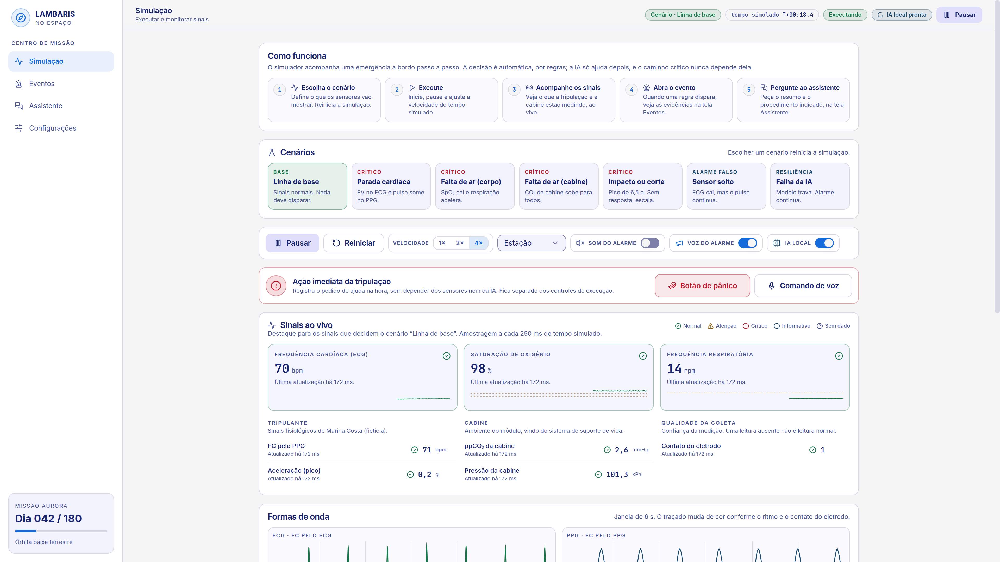
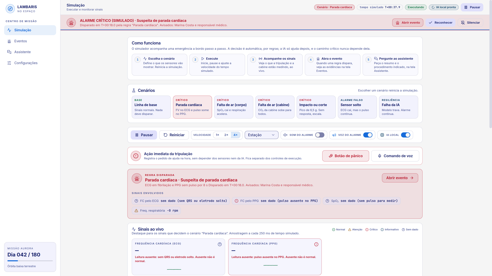
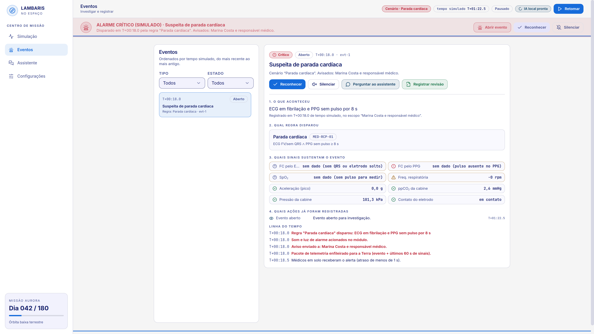
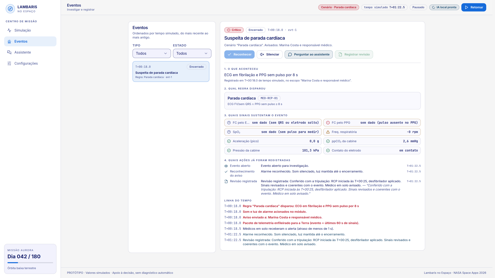
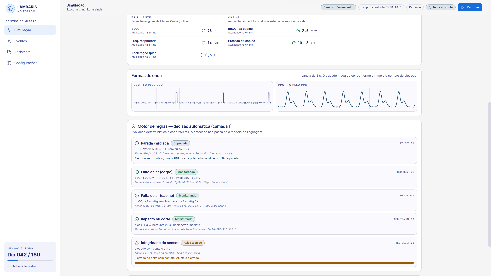
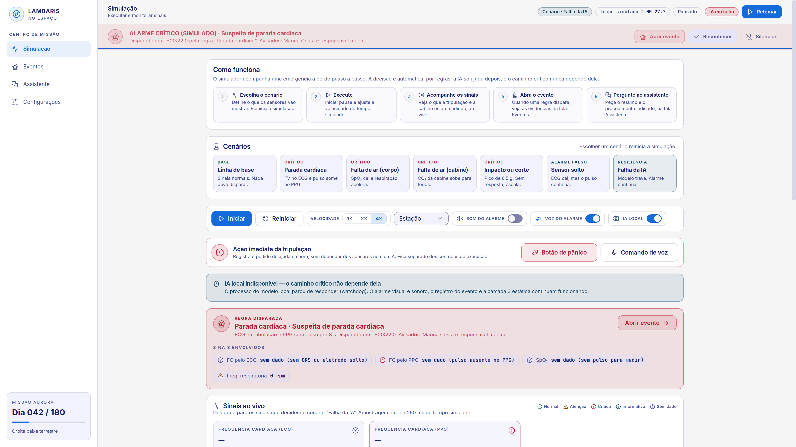

# Lambaris no Espaço: crew health monitoring assistant

**NASA Space Apps Challenge 2026 · Challenge: _Health Monitoring Software_ · Local event: Goiânia (HubGoiás), Brazil**

> **Prototype only. Not a medical device.** All live physiological signals in the demo are **simulated**, the crew member is fictional, and no output of this software is clinical guidance.

## 1. The problem

On long-duration missions, radiation, altered gravity, isolation and a closed, hostile environment affect crew health (immune changes, bone loss, cardiovascular events, sleep and mental-health problems). NASA's Human Research Program groups these into five hazards: radiation, isolation and confinement, distance from Earth, altered gravity fields and hostile/closed environments. Far from Earth, astronauts must notice changes in themselves and decide what to do, and a reading only means something when it is compared with that person's own history and with what is happening in the cabin.

## 2. Our solution

A personal health assistant that gathers crew measurements and self-reports, follows them over time, and **flags changes relative to each astronaut's own baseline**. When it flags something, it shows **which records triggered the flag** and lets the astronaut add context the measurement alone cannot show (for example, a shift change), then records a human review.

The project has two parts:

| Part | Folder | What it shows |
|---|---|---|
| **Onboard event monitor (demo app)** | [`app/`](app/) | Deterministic rules cross simulated crew, cabin and sensor-quality signals and raise a local visual and audible alarm **without waiting for any AI**. Each event opens a detail view (what happened, which rule fired, which signals support it), a timeline of acknowledgements, and a human review form. An optional local AI assistant explains the event and cites the (fictional) procedure it retrieved. |
| **Personal-baseline trend analysis** | [`analysis/`](analysis/) | Sleep-trend detection against each person's own baseline (CUSUM, EWMA and fixed-threshold detectors, benchmarked on simulated series calibrated with Sleep-EDF), plus pre-flight vs post-flight lab baselines from real **Inspiration4** data (NASA OSDR) and space-weather context (NASA DONKI, OSDR RR-1). |

Design principles:

- **The alarm never depends on the AI.** Layer 1 (rules) detects, layer 2 alarms locally; the AI only comes afterwards to explain and retrieve references. If the AI fails, the alarm and the event record still work (see screenshots 16 and 17).
- **Evidence first.** Every alert links to the signals or records that support it, and to the source of its threshold.
- **Personal baseline.** Each crew member is compared with their own history, not only with population ranges.
- **Sensor quality is a signal.** A loose electrode suppresses the rule instead of raising a false cardiac alarm (screenshots 14 and 14b).
- **Human in the loop.** The crew reviews the evidence and records the decision; acknowledge, silence and review are separate actions on the timeline.

## 3. Demo

- **Pitch (local event, Portuguese, 12 slides):** [`docs/pitch-local-event-pt.pdf`](docs/pitch-local-event-pt.pdf)
- **Screenshots:** [`docs/screenshots/`](docs/screenshots/)

| | |
|---|---|
|  Normal state, signals grouped as crew / cabin / data quality |  Critical alarm raised by a deterministic rule |
|  Event detail: what happened, rule, supporting signals |  Human review recorded on the event timeline |
|  Loose sensor: rule suppressed, no false alarm |  AI unavailable: alarm keeps working |

Full list (UI text is in Portuguese): baseline (01–02), cardiac-arrest alarm and rule (03–04), rule engine (05), events and review (06–08), assistant (09), settings and data sources (10–11), cabin CO₂ alarm (12), shortness of breath (13), loose sensor false alarm (14, 14b), impact/disconnect (15), AI failure and watchdog (16–17), mobile layout (18–19).

## 4. How to run

### Quickest: single file, no install

Open [`app/simulador-emergencia.html`](app/simulador-emergencia.html) in a browser. The whole simulation (scenarios, rules, alarms, events, review) runs offline in that one file. Only the AI assistant and server voice need the backend below.

### Full stack (Docker)

Requirements: Docker, and Node.js 18+ to build the interface.

```bash
cd app/web && npm install && npm run build && cd ..
cp .env.example .env
docker compose up
# open http://localhost:8080
```

Compose starts the Python server, **Ollama** (pulls `gemma3:4b`, `medgemma:4b`, `nomic-embed-text` on first run), **Qdrant** (vector search over `procedimentos.json`, fictional procedures) and a **Kokoro** text-to-speech service. All services are optional: without them the app still raises alarms and records reviews, and the Settings screen shows each service's status. Details in [`app/README.pt.md`](app/README.pt.md) (Portuguese).

Stack: Vite, React, TypeScript, Tailwind CSS, shadcn/ui, Lucide icons; Python standard-library server.

### Analysis scripts

```bash
cd analysis
pip install -r requirements.txt
cd sleep-trend
python 02_serie_marina.py     # simulated 30-day sleep series for the fictional crew member
python 03_benchmark.py        # CUSUM vs EWMA vs fixed threshold, 100 simulated series, seed 42
python 04_exames.py           # Inspiration4 CBC table with lab reference ranges
uvicorn api.main:app          # optional demo API (alerts, check-ins, labs)
```

`01_metricas_sono.py` needs the Sleep-EDF hypnogram files (not redistributed here, see section 5); its output `dados/metricas_noites.csv` is included so the other scripts run without them. `inspiration4-labs/limpar_i4.py` and `sleep-simulated/simular_sono.py` use only the Python standard library.

## 5. Data and resources

### NASA data (used)

| Source | What we used | Where | Real or simulated |
|---|---|---|---|
| **NASA OSDR OSD-569** (Inspiration4) | Complete blood count, 4 crew, collections L-92, L-44, L-3, R+1, R+45, R+82, R+194 | `analysis/sleep-trend/nasa/OSD-569/`, `analysis/inspiration4-labs/` | **Real**, pre-flight and post-flight only (no in-flight collections) |
| **NASA OSDR OSD-575** (Inspiration4) | Comprehensive metabolic panel and serum panels | `analysis/sleep-trend/nasa/OSD-575/`, `analysis/inspiration4-labs/` | **Real**, pre/post-flight |
| **NASA OSDR RR-1** radiation data | Daily ISS environment dose (GCR + SAA), 21 Sep to 29 Oct 2014 | `analysis/space-weather/rr1_radiacao_diaria.csv` | Real environmental dosimetry, **not** human dose |
| **NASA DONKI** (api.nasa.gov) | Solar energetic particle (SEP) and geomagnetic storm (GST) events, Nov 2023 to Nov 2026 | `analysis/space-weather/` (download script and summary) | Real event catalog, no dose or flux |
| **NASA-STD-3001** Vol. 1 and Vol. 2, OCHMO technical briefs (CO₂ TB-004, sleep, circadian, behavioral health, longitudinal surveillance, medical operations) | Cabin CO₂ limits and context for the rules; rationale for personal-baseline surveillance | cited in the app (Settings › Data sources) | Standards, used as references |
| **NASA Human Research Program** | The five spaceflight hazards; sleep and circadian evidence reports | cited | References |

### Other public data and references

| Source | Use | License |
|---|---|---|
| **PhysioNet Sleep-EDF Expanded** (Kemp et al., 2000; Goldberger et al., 2000) | Per-night sleep metrics of 42 healthy adults (25–60 y), used to calibrate the simulated sleep series | ODC-By 1.0 |
| **BIG IDEAs Glycemic Variability** (PhysioNet) | Summary statistics of continuous glucose, reference only | ODC-By 1.0 |
| **OpenNeuro ds004902** (sleep deprivation, PVT/KSS/PANAS) | Summary of reaction time and sleepiness, reference only | CC0 |
| **MMASH** (PhysioNet) | Summary of sleep, stress and mood, reference only | ODbL 1.0 (our summary is shared under the same license) |
| AHA/ILCOR 2020 CPR guidelines; StatPearls normal adult vital signs | Illustrative thresholds for the cardiac and respiratory rules | cited only |

Only derived summaries of the non-NASA datasets are included; the raw files are not redistributed. All terrestrial data comes from **people on Earth, not astronauts**, and is labeled that way.

### What is simulated

- All live signals in the app (heart rate, SpO₂, respiration, ECG/PPG, acceleration, electrode contact, cabin CO₂) and the crew member.
- The sleep series used in the trend demo (`serie_marina.csv`, `sono_simulado_demo.csv`), including the injected drop.
- The procedures in `procedimentos.json` and the manual codes (`MED-*`, `AMB-*`, `TEC-*`). They are fictional; real mission medical procedures are not public.

### Space Agency Partner & Other Data

All non-NASA data, models, code, tools and fonts used to build the project. All links are public.

**Data and references**

| Resource | URL |
|---|---|
| MMASH: Multilevel Monitoring of Activity and Sleep in Healthy People (PhysioNet) | https://physionet.org/content/mmash/1.0.0/ |
| BIG IDEAs Lab Glycemic Variability and Wearable Device Data (PhysioNet, Dexcom) | https://physionet.org/content/big-ideas-glycemic-wearable/1.1.2/ |
| OpenNeuro ds004902: sleep deprivation, PVT, KSS, PANAS | https://openneuro.org/datasets/ds004902/versions/1.0.8 |
| Sleep-EDF Database Expanded (PhysioNet) | https://physionet.org/content/sleep-edfx/1.0.0/ |
| CSA Bio-Monitor (Canadian Space Agency, reference) | https://www.asc-csa.gc.ca/eng/sciences/bio-monitor.asp |
| AHA/ILCOR Adult Basic Life Support guidelines (reference) | https://cpr.heart.org/en/resuscitation-science/cpr-and-ecc-guidelines/adult-basic-life-support |
| StatPearls: normal adult vital signs (reference) | https://www.ncbi.nlm.nih.gov/books/NBK593192/ |

**AI models**

| Resource | URL |
|---|---|
| MedGemma-GRPO GGUF (mradermacher, Q4_K_S) | https://huggingface.co/mradermacher/MedGemma-GRPO-GGUF |
| MedGemma 4B (Google) | https://huggingface.co/google/medgemma-4b-it |
| Gemma 3 4B (Google) | https://huggingface.co/google/gemma-3-4b-it |
| nomic-embed-text (Ollama) | https://ollama.com/library/nomic-embed-text |
| paraphrase-multilingual-MiniLM-L12-v2 ONNX (Qdrant/FastEmbed) | https://huggingface.co/Qdrant/paraphrase-multilingual-MiniLM-L12-v2-onnx-Q |
| Kokoro-82M TTS model | https://huggingface.co/hexgrad/Kokoro-82M |
| Piper voice en_US-lessac-medium | https://huggingface.co/rhasspy/piper-voices/tree/main/en/en_US/lessac/medium |
| Claude (Anthropic), AI coding and writing assistant | https://www.anthropic.com/claude |

**Tools and services**

| Resource | URL |
|---|---|
| Ollama | https://github.com/ollama/ollama |
| Qdrant | https://github.com/qdrant/qdrant |
| Kokoro-FastAPI | https://github.com/remsky/Kokoro-FastAPI |
| Piper TTS | https://github.com/rhasspy/piper |
| FFmpeg | https://ffmpeg.org/ |
| Figma (UI prototype) | https://www.figma.com/ |
| Docker | https://www.docker.com/ |
| Python | https://www.python.org/ |
| Noto Sans font (video) | https://fonts.google.com/noto/specimen/Noto+Sans |

**Python libraries:** [NumPy](https://numpy.org/), [pandas](https://pandas.pydata.org/), [Matplotlib](https://matplotlib.org/), [MNE-Python](https://mne.tools/), [FastAPI](https://fastapi.tiangolo.com/), [Uvicorn](https://github.com/encode/uvicorn), [qdrant-client](https://github.com/qdrant/qdrant-client), [FastEmbed](https://github.com/qdrant/fastembed), [pypdf](https://pypdf.readthedocs.io/), [Beautiful Soup](https://www.crummy.com/software/BeautifulSoup/), [Pillow](https://python-pillow.org/).

**JavaScript libraries:** [React](https://react.dev/), [Vite](https://vite.dev/), [TypeScript](https://www.typescriptlang.org/), [Tailwind CSS](https://tailwindcss.com/), [shadcn/ui](https://ui.shadcn.com/), [Radix UI](https://www.radix-ui.com/), [Lucide](https://lucide.dev/), [vite-plugin-singlefile](https://github.com/richardtallent/vite-plugin-singlefile).

No copyrighted material is used without permission. Screenshots and charts are our own.

## 6. Results so far

- The simulated scenarios fire the expected rule within the configured persistence time, and the loose-sensor scenario suppresses the cardiac rule instead of alarming.
- Sleep-trend benchmark (100 **simulated** series, seed 42, `dados/metodo_vencedor.json`): CUSUM detected 82% of injected drops with a median delay of 4 days and a 14% false-alarm rate; EWMA 70% / 4 days / 10%; fixed threshold 74% / 3 days / 8%. These numbers come from series produced by the same generator the detectors were tuned on, so they show the method works in principle, not real-world performance.
- Inspiration4 labs: a pre-flight personal baseline (mean of L-92, L-44, L-3) and percentage change at each post-flight collection, with data-quality flags (one corrupted row, suspected pre-analytical glucose values, inconsistent reference ranges). See `analysis/inspiration4-labs/NOTES_pt.md`.

## 7. Limitations (honest list)

- **Simulated signals.** There is no public in-flight physiological telemetry, so every live signal and the sleep series are simulated.
- **AI not validated.** The assistant uses small general and community medical models (Gemma 3 4B, MedGemma 4B) with retrieval over three fictional procedure texts. It can be wrong; it is not clinically validated, and in our tests it did not run reliably on the team's own laptop. The rules, alarms and interface ran on a laptop with no internet. Nothing was tested on flight hardware.
- **Illustrative thresholds.** Thresholds come from terrestrial references and NASA standards but are illustrative; they were not validated in microgravity. NASA-STD-3001 does not set a numeric escalation threshold: that decision belongs to the flight surgeon.
- **No clinical guidance.** The software does not diagnose, prescribe or recommend doses. The checklists are generic examples, not NASA protocols.
- **Baseline.** In the trend demo the baseline is learned from the first in-flight nights, so a deficit present from the start would look normal. Anchoring to pre-flight data is planned, not implemented.
- **Small real dataset.** Inspiration4 has 4 crew, a 3-day mission and no in-flight samples.
- **Wearables assumed.** Continuous ECG/PPG is not routine for astronauts today; the cardiac rule assumes a wearable such as the CSA Bio-Monitor.
- **Space-weather data is context only.** DONKI and RR-1 describe the environment, not the dose a person received.

## 8. Next steps

1. Validate thresholds and alert wording with a flight surgeon.
2. Anchor each astronaut's baseline to pre-flight data and exclude already-flagged nights from it.
3. Extend tracking to blood pressure, glucose, temperature and mood self-reports, using longitudinal public datasets (e.g. LifeSnaps, PMData) instead of simulation where possible.
4. Measure the false-alarm rate on real multi-week data.
5. Test the AI assistant on embedded hardware, fully offline.

## 9. Use of AI

- **Code:** parts of the app and analysis code were written or reviewed with an AI assistant ([Claude](https://www.anthropic.com/claude), Anthropic). The team reviewed and tested the result.
- **Text:** parts of this README, the data notes, the English translation and the video subtitles were drafted with the same AI assistant and edited by the team.
- **Voice:** the narration of the demo video is AI-generated synthetic speech ([Piper TTS](https://github.com/rhasspy/piper), voice `en_US-lessac-medium`). The in-app narration uses Kokoro TTS. This is also stated in the video.
- **In the product:** Gemma 3 4B and MedGemma 4B (via Ollama) explain events, nomic-embed-text powers retrieval; the team also evaluated the community model MedGemma-GRPO GGUF (Q4_K_S). These are optional and never sit in the alarm path.
- **Images:** screenshots are captures of our own prototype; charts were generated by our code with matplotlib. No AI-generated images are used, and nothing is presented as NASA imagery.

## 10. Team

João Pedro Lima Ribeiro Costa · Rafael Miranda Borba · Miguel Alves Pereira Filho · Sandra Moreira Nunes · Lucas Rikelmi Macedo da Silva · Richard Henrique Monteiro da Cruz

## License

Code: MIT (see [LICENSE](LICENSE)). Third-party data keeps its original license (section 5). NASA data is used under NASA's open data policy; NASA does not endorse this project.
